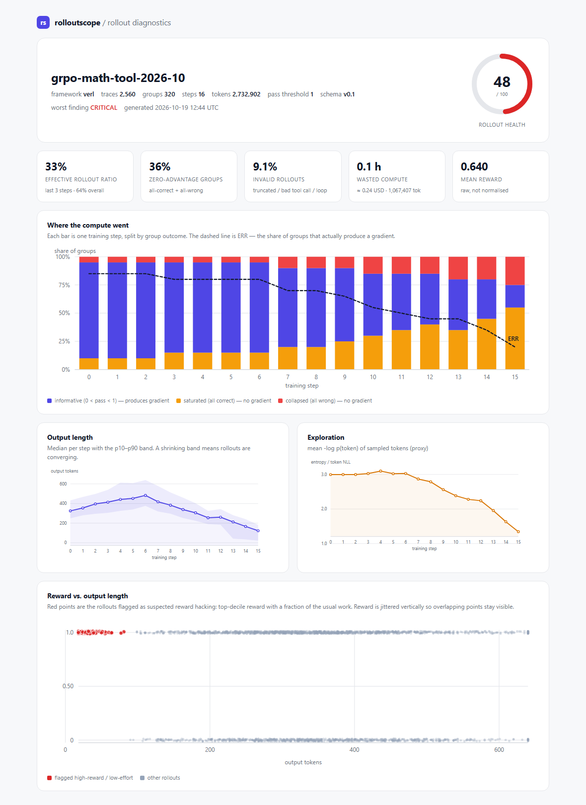

# rolloutscope

**给 RL rollout 做体检的工具。**

简体中文 · [English](README.en.md)

现有工具都在回答「模型生成了什么」——给你一个 trace 浏览器，让你一条条翻。
`rolloutscope` 回答另一个问题：**这一批 rollout 里，有多少是白跑的？白跑的是哪一类？下一步该改什么？**



```bash
pip install rolloutscope
rolloutscope demo
```

不需要 GPU，不需要重跑训练，不需要改训练代码。读你已经有的文件，出一份能截图、能贴进 PR 的 HTML 报告。

---

## 它诊断什么

| 规则 | 回答的问题 | 怎么算 |
| --- | --- | --- |
| `group-difficulty` | 这一步有多少算力是有效的？ | 把每个 GRPO 组分成饱和（pass=1）、有效（0<pass<1）、坍缩（pass=0）三桶；**ERR** = 有效组 / 总组数；梯度信号密度 = `Σ\|A\|` / 千 token |
| `zero-advantage` | 有多少组根本没产生梯度？ | 组内 `σ(reward)=0` ⇒ 所有 `A_i=0`；再拆成「全对」和「全错」，并把浪费的 token 换算成 GPU 小时 |
| `entropy-collapse` | 策略是不是不再探索了？ | 逐步取熵中位数（或 `-log p(token)` 代理），与早期基线比，连续低于 60% 判为坍缩 |
| `length-collapse` | 模型是不是学会闭嘴了？ | 输出长度中位数对比基线，同时看步内长度变异系数；区分「有意的长度惩罚」（reward 同步涨）和「坍缩」（reward 不涨） |
| `reward-hacking` | reward 是不是被钻空子了？ | 同步内 reward 进前 10%，且长度低于中位数 35% 或工具调用低于中位数 20%；再算「短 ⇒ 高分」的 lift 作旁证 |
| `invalid-rollout` | 有多少 rollout 一出生就废了？ | 截断、工具参数不是合法 JSON、工具调用语法漏进正文、空输出、重复同一调用 |

每条结论都带：一个数字、可以点开的 trace id、一个具体动作。没有证据的「质量偏低」不会出现在报告里。

## 为什么需要它

三件事同时成立：

1. **大家都在记 rollout，但没人分析。** verl 自带 `rollout_trace`（weave / mlflow / trackio），TRL 会记 completions，rLLM 有自己的 UI——每个都是「某个框架的查看器」。
2. **最关键的指标已经被发现了，但被压成了一个标量。** TRL 记 `frac_reward_zero_std`，verl 记 entropy 和 response length，可是没人告诉你**是哪几道题**浪费了这一步，也分不出「零方差」是因为题太简单还是太难。
3. **把所有 token 传上 SaaS 不现实。** verl 官方文档自己写着：训练期间每天产生几十 GB trace 数据，而 Weave 免费额度是 1 GB/月。

`rolloutscope` 就是中间那层：本地文件进，一份体检报告出。

## 核心概念：全对组为什么没有梯度

GRPO 在组内做归一化：

```
A_i = (r_i − mean(r)) / (std(r) + ε)
```

如果同一个 prompt 的 n 条 rollout 拿到**完全一样**的 reward，`std = 0`，于是每一条的 advantage **恰好是 0**。这一组对梯度的贡献是零——但它的前向、reward 计算、工具调用已经全部花掉了。

这个故障有两种完全不同的成因，修法相反：

- **全对** → 题目太简单，该降采样、退役，或者提高难度；
- **全错** → 题目太难，该加 hint、加示例，或者用动态基线让全错组也能产生信号。

TRL 的 `frac_reward_zero_std` 是一个标量，看不出你处在哪一种。`rolloutscope` 把它拆开、按 step 归因、再标上价。

## 快速开始

```bash
pip install rolloutscope

# 1) 合成一份带病理的示例（离线、无 GPU、固定随机种子）
rolloutscope demo
open demo/out/report.html

# 2) 扫自己的产物，格式自动识别
rolloutscope report ./checkpoints/exp1/rollout_dump --out report.html

# 3) 放进 CI，健康分低于阈值就失败
rolloutscope scan ./rollout_dump --fail-under 60 --json findings.json

# 4) 导出成 OTel，接着用你现有的观测平台
rolloutscope convert ./rollout_dump --to otel --out spans.json
```

`demo` 会写出四份产物，正好是四种输入格式的样例：

| 路径 | 是什么 |
| --- | --- |
| `demo/out/traces.jsonl` | 原生 `AgentTrace` schema（带文本），主报告用的就是它 |
| `demo/out/verl_dump/` | verl 形状的 parquet（`uid`、`responses`、`response_mask`、`rollout_log_probs`、`rm_scores`） |
| `demo/out/trl_run/` | TRL 的 `trainer_state.json` + `completions.jsonl` |
| `demo/out/spans.json` | 同一批数据的 OTLP/JSON spans |

```bash
rolloutscope report demo/out/verl_dump     # 只有 token id，和真实 verl dump 一样
rolloutscope report demo/out/trl_run       # 只有指标时也能跑（降级模式）
rolloutscope report demo/out/spans.json --adapter otel
```

### 示例报告读出了什么

一份 16 步、2560 条 trace 的 GRPO 运行，健康分 **48/100**：

- 整体 **ERR 64%，但最近 3 步只有 33%**——平均分掩盖了正在发生的退化；
- 35.6% 的组零优势（25% 全对 + 11% 全错），约 90 万 token 白跑；
- 9.1% 的 rollout 无效，其中 4.3% 是工具调用参数不是合法 JSON；
- 输出长度掉到基线 **35%**，熵掉到 **45%**，且是连续的；
- 4.8% 的 rollout 疑似刷分（reward 前 10%、工作量不到中位数三分之一）。

而 **reward 曲线是往上走的**。这就是「训练不涨、指标好看」的完整证据链。

## 支持哪些输入

不同产物能提供的信息不一样，报告会明说，而不是猜：

| 输入 | reward | 长度 | 工具调用 | logprob | 文本 |
| --- | --- | --- | --- | --- | --- |
| 原生 `AgentTrace` jsonl | ✅ | ✅ | ✅ | 可选 | ✅ |
| verl parquet dump | ✅ `rm_scores` | ✅ `response_mask` | ❌ | ✅ `rollout_log_probs` | 需 `--tokenizer` |
| TRL completions 表 | ✅ | ✅ | ❌ | ❌ | ✅ |
| TRL `trainer_state.json` | 仅聚合 | ✅ | ❌ | 熵标量 | ❌ |
| OTel spans | ✅ `rolloutscope.reward` | ✅ | ✅ | 仅聚合 | ✅ |

看不见输入的规则会**带原因跳过**，绝不编。这就是为什么同一批数据在原生 dump 上 `invalid` 是 9%，在 verl parquet 上是 6%：parquet 没有 tool-call 列，工具格式错误在那里根本不可见。

## Schema：OTel 的超集，不是新标准

`AgentTrace` 不是又一个格式。一次 rollout 会输出成一棵任何 GenAI 后端都认识的 OTel trace：

```
invoke_agent {agent}                gen_ai.operation.name = invoke_agent
├── chat {model}                    gen_ai.usage.*, gen_ai.input.messages, gen_ai.response.finish_reasons
│   └── execute_tool {tool}         gen_ai.tool.name / call.id / call.arguments / call.result
└── chat {model} ...
```

OTel 目前描述不了的 RL 维度，用 `rolloutscope.*` 扩展属性挂上去，不污染 `gen_ai.*` 命名空间：

| 属性 | 含义 |
| --- | --- |
| `rolloutscope.train.step` | 训练步 |
| `rolloutscope.group.id` | GRPO 分组（同一 prompt） |
| `rolloutscope.rollout.index` | 组内第 n 个采样 |
| `rolloutscope.reward` / `.advantage` | 标量 reward / 归一化后的 advantage |
| `rolloutscope.status` / `.invalid.reason` | `ok` / `invalid` + 原因 |
| `rolloutscope.schema.version` | schema 版本 |

```python
from rolloutscope import load, analyze
from rolloutscope.otel import to_otlp

batch = load("./rollout_dump")      # 自动识别 verl / TRL / generic / OTel
report = analyze(batch)
print(report.score, report.summary)

spans = to_otlp(batch)              # 喂给任意 OTel 后端
```

映射是双向的：已经用 OpenInference / Langfuse / Traceloop 埋过点的 agent，导出 span 就能直接诊断，不用改代码——`rolloutscope report spans.json --adapter otel`。

## 配置

所有阈值集中在一个 dataclass，可以用 JSON 覆盖：

```bash
rolloutscope scan ./dump --config rolloutscope.json --pass-threshold 1.0
```

```json
{
  "zero_adv_std": 1e-6,
  "pass_threshold": 1.0,
  "entropy_drop_ratio": 0.6,
  "length_drop_ratio": 0.6,
  "hack_reward_quantile": 0.9,
  "hack_length_ratio": 0.35,
  "weight_zero_adv": 30,
  "weight_invalid": 25,
  "tokens_per_second": 2500,
  "cost_per_gpu_hour": 2.0
}
```

**健康分**是加权和，公式写在报告里，也写在 `diagnostics/base.py` 里：

```
score = clip(100 − [30·零优势占比 + 25·无效占比 + 20·min(刷分率/0.2, 1)
                    + 15·熵坍缩深度 + 10·长度坍缩深度], 0, 100)
```

它是用来跟踪同一条训练曲线变化的启发式分数，不是 benchmark。

## 设计原则

1. **零侵入。** 读训练器已经写下的东西。要求重跑训练会直接杀死采用率。
2. **用标准，不造标准。** 底下是 OTel GenAI，上面挂 `rolloutscope.*`。
3. **每条结论都可行动。** 现象 → 数字 → 证据 → 成因 → 修法 → 代价。
4. **Fail soft。** 缺一列就跳过一条规则，绝不让报告崩掉。

## 开发

```bash
python -m venv .venv && .venv/Scripts/activate      # Windows
pip install -e ".[dev]"
pytest
ruff check src tests
```

运行期依赖只有 `pandas` 和 `numpy`；读 parquet 需要 `pyarrow`（可选）。报告是纯内联 SVG，没有 CDN、没有 JS 库，离线可开。

## 路线图

- [x] v0.1：schema + OTel 双向映射 + verl/TRL/通用/OTel 四个适配器 + 六条规则 + 离线报告
- [ ] v0.2：在真实 verl / TRL 实验上校准阈值，补 `rolloutscope diff A B`
- [ ] v0.3：把 `rolloutscope.*` 扩展属性整理成 OTel semconv 提案；规则可插拔
- [ ] v0.4：发布 PyPI，补「为什么全对组没有梯度」的实测博客

## 许可证

MIT
